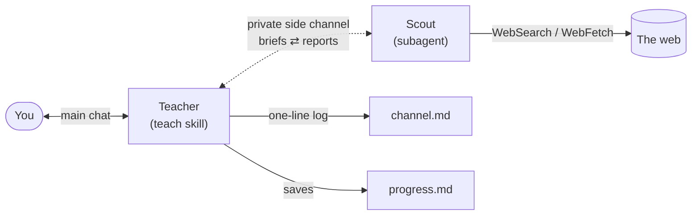

# Claude Teacher Skill

A personal teacher for Claude Code. Name any concept and Claude works out
where you're starting from, teaches it one step at a time, checks that you
actually understood, and shows you the best learning materials at the moment
each one helps.

The materials come from a **scout**: a second agent that searches the web
while you learn. The scout never talks to you. It reports to the teacher in a
private side channel, and the teacher decides what is worth your time. You get
one good link when you need it, not a pile of twenty search results.

```
/teach fourier transform
```

Free, MIT, no API keys, nothing to sign up for.

## How it works



1. **You ask** with `/teach <concept>` or just "teach me X".
2. **The scout starts searching** in the background with a first brief.
3. **The teacher diagnoses you** with one or two quick questions (your goal and
   what you already know) while the scout works.
4. **The scout reports back to the teacher, not to you.** Its report lists
   resources with their level, format, estimated time, whether it opened them,
   a quality score, caveats, and the gaps it couldn't fill.
5. **The teacher teaches.** It explains, gives an example, asks a check
   question, and adapts to your answer. When a resource beats its own
   explanation (a visualization, a worked video, an exercise set), it shows
   you that one resource and tells you what to look for.
6. **When you get stuck,** the teacher sends the scout a targeted brief, such
   as "a visual intuition for X at beginner level", and keeps going.
7. **Your progress is saved,** so running the command again with the same
   concept resumes where you left off.

### Why a side channel?

If a research agent posts straight into your chat, you get noise: every link
it found, half of them at the wrong level. Here the scout writes only for the
teacher. In Claude Code, a subagent's result goes back to the agent that
launched it. It is not posted into the conversation, and at most it appears as
collapsed tool output. The teacher sends follow-up briefs to the same scout by
name, so the two hold a running conversation out of your way.
`~/.claude/teacher/<topic>/channel.md` keeps a one-line-per-message log of
that exchange.

## What a session looks like

An illustrative excerpt (the links are real results from a scout run on this
topic):

```
> /teach big-o notation

Teacher: Before we start, two quick questions…
  [Goal: interview prep]  [Starting point: I can write Python loops]

Teacher: Big-O answers one question: when the input doubles, what happens to
the work? A single loop over a list does twice the work, so it's O(n)…

Quick check: this function loops over a list, and inside that loop it loops
over the same list again. What happens to the work when the list doubles?

> it doubles?

Teacher: Close, but the inner loop also got twice as long. Twice as many outer
steps, each doing twice as much work, means 4× the work. That's O(n²)…

To see it, open this and push n up to watch O(n²) pull away:
https://web-apps.thecoatlessprofessor.com/coding/big-o-visualizer.html
```

## What's inside

| Component | Type | What it does |
| --- | --- | --- |
| [`teach`](skills/teach/SKILL.md) | Skill | The teacher. Diagnoses your level, runs the explain → show → check → adapt loop, vets and curates resources, briefs the scout, and saves progress. |
| [`scout`](agents/scout.md) | Subagent | The researcher. Searches the web with read-only tools, opens the best candidates to verify them, and returns a structured report to the teacher only. |

## Install

**Option 1: ask Claude.** Paste this into Claude Code:

```
https://github.com/mustafa-hidiroglu/claude-teacher-skill

Install this skill and its scout agent globally.
```

**Option 2: manual install**

```bash
git clone https://github.com/mustafa-hidiroglu/claude-teacher-skill.git
mkdir -p ~/.claude/skills ~/.claude/agents
cp -r claude-teacher-skill/skills/teach ~/.claude/skills/
cp claude-teacher-skill/agents/scout.md ~/.claude/agents/
```

For a single project instead, copy them into the repo's `.claude/skills/` and
`.claude/agents/`.

**Option 3: as a plugin**

```
/plugin install teacher --marketplace mustafa-hidiroglu/claude-teacher-skill
```

On Claude Code older than 2.1.275, add the marketplace first:

```
/plugin marketplace add mustafa-hidiroglu/claude-teacher-skill
/plugin install teacher@claude-teacher-skill
```

As a plugin, the command is `/teacher:teach` and the agent is `teacher:scout`.

**Then restart Claude Code** so the scout agent loads. Until you do, the
teacher still teaches, but without web materials.

## Usage

```
/teach recursion
/teach how transformers work, I know basic linear algebra
teach me Bayesian statistics for an exam next week
/teach recursion            ← later: resumes from progress.md
```

While learning you can say things like:

- `slower` / `harder` / `skip`
- `quiz me`
- `give me resources`: the teacher shows what it has been holding back
- `where do these links come from?`: it explains and points you to `channel.md`

## Files it keeps

All state is local, in `~/.claude/teacher/<topic>/`:

| File | Contents |
| --- | --- |
| `progress.md` | Your goal, level, preferred formats, what's solid, what's shaky, what's next, and resources already shown |
| `channel.md` | One line per side-channel message: each brief sent and a summary of each report returned |

Delete a topic folder to start that topic fresh, or delete
`~/.claude/teacher/` to clear everything.

## Safety

- **The scout is read-only.** Its only tools are `WebSearch` and `WebFetch`.
  It can't write files or run commands. If the scout agent isn't loaded, the
  teacher does not substitute a general-purpose agent. It teaches without web
  materials instead.
- **Web pages are treated as data.** The scout is told never to follow
  instructions found on a page and to flag injection attempts under
  `WARNINGS`. Scout reports never trigger actions by the teacher, and the
  teacher never relays install commands or package names from them.
- **Links are vetted.** Only resources the scout actually opened are shown.
  Each one is https, printed as a full URL rather than hidden behind link text,
  and never a URL shortener, a raw IP address, a lookalike domain, a direct
  download, or a page that needs login or payment.
- **Topic names are sanitized** before they become folder names, so nothing is
  written outside `~/.claude/teacher/`.

## Requirements

- [Claude Code](https://claude.com/claude-code)
- `WebSearch` and `WebFetch` allowed for the scout. It runs in the background
  and can't stop to ask for permission, so allow them in `/permissions` (or in
  `permissions.allow` in your settings). Without them, the teacher still works
  but can't verify or show outside materials.

## Customizing

- **Scout model:** `model: sonnet` in `agents/scout.md`. Switch to `haiku` for
  cheaper sweeps or `opus` for harder topics.
- **Teaching style:** edit §5 of `skills/teach/SKILL.md`, for example to ask
  more check questions or lean on exercises.
- **Report format:** the scout's report template is in `agents/scout.md`. If
  you add fields, update §4 of the skill to use them.

## Uninstall

```bash
rm -rf ~/.claude/skills/teach ~/.claude/agents/scout.md
rm -rf ~/.claude/teacher        # optional: your learning progress
```

Plugin install: `/plugin uninstall teacher`.

## License

MIT, see [LICENSE](LICENSE).
